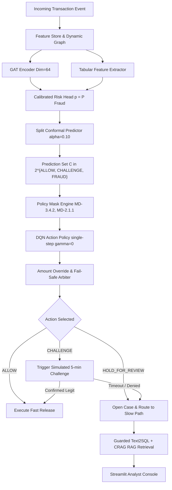

# FraudSense Prototype: System Architecture & Implementation Plan

> **DISCLAIMER**: **RESEARCH CAPSTONE PROTOTYPE ONLY. SIMULATED DATA & POLICY RETRIEVAL.**
> This system is designed exclusively for academic demonstration and research into relational fraud detection and conversational compliance for Indian digital payment systems. It runs strictly on public/simulated datasets and is **never deployable** in production. All regulatory outputs and customer-facing interactions are synthetic and explicitly stamped with `SIMULATED`.

---

## 1. Project Overview & Non-Negotiable Guardrails

`FraudSense` is an end-to-end framework integrating graph neural networks (GAT), split conformal prediction, reinforcement learning (DQN) action policies, deterministic compliance guardrails, and slow-path conversational enrichment (CRAG-style RAG and guarded Text2SQL).

### Core Guardrails
1. **Zero External Action / Strict Simulation**: No real banking networks, SMS gateways, customers, or regulator endpoints (e.g. RBI CPFIR/FMR portals) are invoked. Every action is marked `SIMULATED`.
2. **Deterministic RBI Policy Grounding**: RAG operates exclusively on verified clauses extracted from `data/policy/clauses.json`. The system never invents or hallucinates clause IDs or statutory text.
3. **Strict Fast-Path Latency & Architecture Boundary**:
   - **Fast Path (Transaction Scoring & Routing, budget $\le 200\text{ ms}$)**: Evaluates tabular features, incremental GAT embeddings, calibrated probabilities, split-conformal prediction sets, policy masks, and DQN actions. **Zero LLM or heavy text generation calls**.
   - **Slow Path (Case Enrichment & Analyst Copilot)**: Asynchronous case packaging, guarded Text2SQL querying, CRAG policy retrieval, and report drafting.
4. **Fail-Safe Decision Guarantees**:
   - A challenge timeout **never releases** funds; it defaults strictly to `HOLD_FOR_REVIEW`.
   - Scoring service failure/timeout triggers fallback: amounts $< \text{low\_value\_threshold}$ are allowed; amounts $\ge \text{high\_value\_threshold}$ are challenged.
   - Large-value holds require supervisor approval before release.
5. **Auditing & Reproducibility**:
   - Append-only audit log for every score, prediction set, policy mask evaluation, router decision, and analyst action.
   - All proposed parameters configurable via `config/params.yaml`.
   - Default deterministic local fallback for Text2SQL and RAG templates ensuring zero dependency on external paid API keys.

---

## 2. Directory & Repository Structure

```text
fraudsense/
├── config/
│   └── params.yaml                   # Global thresholds, reward weights, model specs, timers
├── data/
│   ├── raw/                          # PaySim, IEEE-CIS, European Credit Card CSVs
│   ├── processed/                    # Normalized parquet/sqlite caches
│   └── policy/
│       └── clauses.json              # Curated, paraphrased RBI Master Direction clauses
├── src/
│   └── fraudsense/
│       ├── __init__.py
│       ├── ingest/                   # Schema normalization, dataset loaders, event replay
│       │   ├── __init__.py
│       │   ├── schema.py             # Unified TransactionEvent dataclass / Pydantic schema
│       │   ├── paysim_loader.py
│       │   ├── ieee_loader.py
│       │   ├── european_loader.py
│       │   └── replay.py             # Strict timestamp-ordered event generator
│       ├── graph/                    # Dynamic PyTorch Geometric graph pipeline
│       │   ├── __init__.py
│       │   ├── builder.py            # Heterogeneous/bipartite graph constructor
│       │   ├── temporal.py           # Recency-weighted edge decay (72h half-life/window)
│       │   └── sampler.py            # Neighbor sampling for mini-batch inductive inference
│       ├── features/                 # Account-level & transaction feature store
│       │   ├── __init__.py
│       │   ├── precomputed.py        # Account historical aggregates (velocity, ratios)
│       │   └── service.py            # Real-time feature assembly (tabular + graph embeddings)
│       ├── models/
│       │   ├── __init__.py
│       │   ├── gat.py                # 2-layer, 4-head Graph Attention Network (dim=64)
│       │   ├── risk_head.py          # Calibrated MLP classifier (Temperature Scaling)
│       │   ├── conformal.py          # Lightweight split conformal calibrator (approx. 50 lines)
│       │   ├── dqn.py                # Action policy network & replay buffer (< 300 lines)
│       │   ├── baselines.py          # Baseline A (GBDT), Baseline B (Cost-Sensitive)
│       │   └── explain.py            # TreeSHAP (tabular) & GNNExplainer (subgraph)
│       ├── policy/
│       │   ├── __init__.py
│       │   ├── mask.py               # Deterministic action filtering via clause rules
│       │   └── override.py           # Hard amount overrides (>= high_value_threshold)
│       ├── decision/
│       │   ├── __init__.py
│       │   └── router.py             # Multi-stage arbitrator (Mask + Conformal + DQN + Fail-Safe)
│       ├── scoring/
│       │   ├── __init__.py
│       │   ├── api.py                # FastAPI microservice for sub-200ms scoring
│       │   └── schemas.py            # Request/Response DTOs
│       ├── cases/
│       │   ├── __init__.py
│       │   ├── state_machine.py      # Strict case lifecycle transitions
│       │   └── service.py            # Case creation, assignment, supervisor escalations
│       ├── challenge/
│       │   ├── __init__.py
│       │   └── handler.py            # Simulated user challenge with timeout-to-hold logic
│       ├── feedback/
│       │   ├── __init__.py
│       │   ├── label_service.py      # Simulated maturity window (7 days) & dispute ingestion
│       │   ├── weights.py            # Inverse propensity scoring / importance weighting
│       │   └── reward.py             # Payoff matrix calculator (-alpha*A, etc.)
│       ├── enrichment/
│       │   ├── __init__.py
│       │   ├── text2sql.py           # Guarded SELECT queries (AST parser, table allowlists)
│       │   ├── rag.py                # Hybrid BM25 + dense sentence-transformers + CRAG check
│       │   ├── templates.py          # Pre-approved notification templates bound to clause IDs
│       │   └── reporting.py          # Simulated CPFIR & FMR draft generators
│       ├── audit/
│       │   ├── __init__.py
│       │   └── log.py                # Append-only SQLite audit log writer
│       ├── monitoring/
│       │   ├── __init__.py
│       │   ├── metrics.py            # PSI, false-hold rate, coverage, p99 latency
│       │   └── drift.py              # Distribution divergence monitoring
│       └── simulation/
│           ├── __init__.py
│           ├── customer.py           # Simulated challenge responders (p_confirm_legit, p_deny_fraud)
│           ├── analyst.py            # Simulated analysts with configurable error rate
│           └── clock.py              # Virtual replay clock for synthetic timer progression
├── app/
│   ├── analyst_ui.py                 # Streamlit operational console
│   └── components/                   # Graph visualizers, case tables, RAG inspectors
├── scripts/
│   ├── run_replay.py                 # End-to-end replay driver
│   ├── train.py                      # Multi-model training harness
│   ├── evaluate.py                   # Evaluation metrics, cost/10k, PR-AUC, calibration curve
│   └── red_team.py                   # Adversarial stress tests (SQL injection, evasion, prompts)
├── tests/
│   ├── test_ingest.py
│   ├── test_graph.py
│   ├── test_conformal.py
│   ├── test_dqn.py
│   ├── test_decision_router.py
│   ├── test_case_state_machine.py
│   ├── test_enrichment.py
│   └── test_red_team.py
├── docs/
│   ├── DECISIONS.md                  # Comprehensive decision log & architectural trade-offs
│   └── results.md                    # Baseline vs. GAT+DQN comparative benchmarks
├── reports/                          # Generated evaluation figures, CSVs, and audit extracts
├── requirements.txt                  # Pinned dependencies
└── README.md
```

---

## 3. Data Ingestion & Unified Schema

All datasets are normalized into a unified timestamped stream:
$$\text{Event} = \langle \text{event\_id}, \text{ts}, \text{amount}, \text{payer\_id}, \text{payee\_id}, \text{channel}, \text{device\_id}, \text{label} \rangle$$

1. **PaySim**:
   - `step` mapped to simulated hourly timestamps (`datetime(2025, 1, 1) + timedelta(hours=step)`).
   - `nameOrig` $\to$ `payer_id`, `nameDest` $\to$ `payee_id`, `amount` $\to$ `amount`, `isFraud` $\to$ `label`.
   - `channel` inferred from transaction type (e.g., `TRANSFER`, `CASH_OUT`).
2. **IEEE-CIS Fraud Detection**:
   - `TransactionDT` (offset seconds from reference epoch) $\to$ `ts`.
   - `card1`..`card6` + `addr1` composite $\to$ `payer_id`, `P_emaildomain` / `DeviceType` $\to$ `payee_id` / `device_id`.
   - Joined with `train_identity.csv` on `TransactionID`.
3. **European Credit Card Fraud**:
   - `Time` (seconds from first transaction) $\to$ `ts`.
   - Tabular-only benchmarks ($V_1 \dots V_{28}$, `Amount`, `Class`). Synthetically assigned to default channel for standalone risk head/DQN sanity tests.

---

## 4. Modeling, Decision & Control Pipeline



### 4.1 Split Conformal Prediction
- **Conformity Score**: Nonconformity defined on calibrated probability vector $\hat{p} = [p_{\text{allow}}, p_{\text{challenge}}, p_{\text{fraud}}]$:
  $$s(x, y) = 1 - \hat{p}_y$$
- **Calibration**: On held-out calibration split of size $n$, compute empirical quantile $\hat{q} = \text{Quantile}\left(\{s_i\}_{i=1}^n, \frac{\lceil (n+1)(1-\alpha) \rceil}{n}\right)$ where $\alpha = 0.10$ (target coverage $90\%$).
- **Prediction Set Generation**:
  $$C(x) = \{y \in \mathcal{Y} \mid 1 - \hat{p}_y \le \hat{q}\} = \{y \in \mathcal{Y} \mid \hat{p}_y \ge 1 - \hat{q}\}$$

### 4.2 Policy Mask & Amount Override
- Restricts actions based on regulatory principles:
  - If no formal case record can be created, `HOLD_FOR_REVIEW` is masked out.
  - If amount $\ge \text{high\_value\_threshold}$ ($₹50,000$), action must be at least `CHALLENGE`. If $C(x)$ contains `FRAUD`, action is forced to `HOLD_FOR_REVIEW`.
  - Supervisor approval gate required before closing holds over $₹50,000$.

### 4.3 DQN Action Selection
- **State**: Concatenation of conformal set one-hot encoding (8 binary states), amount log-scale bucket, calibrated risk score $p$, and account graph centrality / velocity features.
- **Action Space**: $\mathcal{A} = \{\text{ALLOW}, \text{CHALLENGE}, \text{HOLD\_FOR\_REVIEW}\}$.
- **Optimization**: Single-step contextual bandit ($\gamma = 0$), matching the per-payment risk objective. Reward matches the operational payoff function below.

### 4.4 Operational Payoff Matrix (Cost Minimization)
| Action | Actual Legitimate | Actual Fraudulent |
|---|---|---|
| **ALLOW** | $0$ | $-\alpha \cdot \text{Amount} \quad (\alpha = 1.0)$ |
| **CHALLENGE** | $-u \quad (u = ₹5)$ | $-\lambda \cdot \text{Amount} \quad (\lambda = 0.2)$ |
| **HOLD** | $-h - \rho \cdot \text{Amount} \quad (h=₹300, \rho=0.01)$ | $+\gamma \cdot \text{Amount} - c_a \quad (\gamma = 0.9, c_a = ₹150)$ |

---

## 5. Slow Path: Conversational Compliance & RAG Architecture

1. **RAG Knowledge Base**:
   - Ingestion strictly limited to `data/policy/clauses.json` (RBI Master Directions).
   - Hybrid retrieval: BM25 (`rank_bm25`) + Dense (`sentence-transformers/all-MiniLM-L6-v2`).
   - Reciprocal Rank Fusion (RRF) with minimum confidence check ($\text{score} \ge 0.35$). If confidence is below threshold, output exact string: `"No applicable clause found"`.
   - Enforce clause ID citations (`[MD-X.X.X]`) in every generated output.
2. **Guarded Text2SQL**:
   - Default deterministic template mapper for common queries (e.g., account balance history, shared device clusters, counterparty risk).
   - Pluggable LLM adapter with strict security guardrails:
     - Regex & AST syntax validation: Must be exactly one `SELECT` statement.
     - Table allowlist: `[payment_event, feature_snapshot, score_record, decision_record, case_record]`.
     - Block comments, `PRAGMA`, `ATTACH`, `UNION` with hidden tables, and any DDL/DML (`DROP`, `UPDATE`, `INSERT`, `DELETE`).
     - Hard caps: `LIMIT 500`, query execution timeout of $5\text{ s}$.
3. **Pre-Approved Customer Templates**:
   - Zero runtime unconstrained text generation for end-users. All SMS/In-App challenge messages reference fixed templates tagged with corresponding clause IDs (e.g., `MD-3.4.2`).
4. **Draft Regulatory Reports**:
   - Synthetic CPFIR (Central Payments Fraud Information Registry) and FMR-1 return drafting saved to local artifacts as `SIMULATED_CPFIR_<case_id>.json` and `SIMULATED_FMR_<case_id>.json`.

---

## 6. Phased Implementation Roadmap

Each phase is self-contained with unit and integration tests. We will pause and solicit approval after each phase.

### Phase 1: Repository Skeleton, Config, Ingest & Replay
- Setup directory tree, virtual environment dependencies, `config/params.yaml`, and `data/policy/clauses.json`.
- Implement `schema.py`, dataset loaders (`paysim_loader.py`, `ieee_loader.py`, `european_loader.py`), and unified time-ordered event iterator `replay.py`.
- **Deliverable**: Working event stream CLI, unit tests verifying unified schema formatting, monotonicity of replay timestamps, and clause format validation.

### Phase 2: Graph Builder, Features, Baselines & Evaluation
- Build PyG dynamic bipartite/projection graph builder with recency decay.
- Implement account feature service (velocity, rolling fraud rates).
- Implement Baseline A (LightGBM/XGBoost on tabular features) and Baseline B (cost-sensitive thresholding).
- Create evaluation harness `scripts/evaluate.py` (PR-AUC, cost/10k, recall at 0.5%, 1%, 2% false-hold rates).
- **Deliverable**: Baseline performance benchmarks reported in `docs/results.md`.

### Phase 3: GAT Encoder, Calibrated Risk Head & Conformal Calibrator
- Implement 2-layer, 4-head PyG GAT model with inductive neighbor sampling.
- Implement MLP Risk Head with Temperature Scaling calibration.
- Implement transparent ~50-line split conformal calibrator with guaranteed finite-sample coverage ($\ge 90\%$).
- Compute SHAP top-5 features and GNNExplainer k-hop subgraph masks.
- **Deliverable**: Calibration curves, empirical conformal coverage checks, and GNNExplainer test suite.

### Phase 4: Policy Mask, DQN Policy, Decision Router & Reward Engine
- Implement deterministic policy mask mapping clause flags and thresholds to valid action sets.
- Implement PyTorch DQN action policy (< 300 lines) with $\gamma=0$ and epsilon-greedy exploration.
- Implement `decision/router.py` adhering to Section 5 priority rules and 200ms fail-safe fallback.
- Implement reward evaluation engine.
- **Deliverable**: Benchmark comparison across Baseline A, Baseline B, Risk Head Alone, and Full GAT+DQN pipeline in `docs/results.md`.

### Phase 5: Fast Scoring API, SQLite Audit Store, Challenge Simulator & Case State Machine
- Implement FastAPI scoring service `/score` with latency tracking.
- Create SQLite persistence schema (`payment_event`, `decision_record`, `audit_log`, `case_record`, etc.) and migration script.
- Build challenge handler with simulated customer behavior and 5-minute timeout escalation.
- Implement case lifecycle state machine (`OPENED` $\to$ `ENRICHED` $\to$ ... $\to$ `CLOSED`).
- **Deliverable**: Passing end-to-end scoring API tests, audit trail verification, and case transition validation.

### Phase 6: Feedback Loop, Label Delay & Importance Weighting
- Implement maturity delay queue (`label_maturity_sim_days = 7`).
- Implement random audit sampling of ALLOW decisions (`random_audit_rate = 0.01`).
- Implement inverse propensity scoring / importance weighting to rectify selection bias on reviewed payments.
- Attach labels to `decision_id` and compute actualized rewards.
- **Deliverable**: Retraining buffer tests confirming no provisional or un-matured labels leak into training sets.

### Phase 7: Slow-Path Enrichment (Guarded Text2SQL, CRAG RAG & Regulatory Drafts)
- Index `clauses.json` with BM25 + dense sentence embeddings.
- Implement CRAG fallback check (confidence $\ge 0.35$ or return `"no applicable clause found"`).
- Implement parameterised Text2SQL query engine with SQL injection defense and allowlist filters.
- Implement pre-approved template selector and SIMULATED CPFIR/FMR report drafting.
- **Deliverable**: Prompt injection and SQL injection test suite passing with 100% rejection.

### Phase 8: Streamlit Analyst Console
- Build interactive multi-page dashboard:
  - Open Cases Queue (filtered by urgency, amount, state).
  - Detailed Case Inspection (SHAP feature bar, PyG subgraph visualization, Text2SQL query history, policy clause citations).
  - Action Panel with mandatory reason code, clause picker, and supervisor escalation flow.
  - Persistent red warning banner: `"PROTOTYPE. SIMULATED DATA. NO REAL CUSTOMERS OR REPORTS."`
- **Deliverable**: Interactive operational demo running on localhost.

### Phase 9: Monitoring, Red-Teaming, Documentation & Polish
- Implement Population Stability Index (PSI) drift monitoring and hold-rate alerts.
- Execute adversarial test suite `scripts/red_team.py` (graph camouflage, feature perturbation, SQL injection, prompt injection).
- Finalize `docs/DECISIONS.md`, `README.md`, and generate final comparison reports in `reports/`.
- **Deliverable**: Full prototype sign-off meeting definition of done.

---

## 7. Key Assumptions & Technical Formulations

1. **Nonconformity Metric**:
   $$s(x, y) = 1 - \hat{P}(Y = y \mid x)$$
   For binary/ternary classification, this formulation yields intuitive, monotone prediction sets: smaller probability values yield nonconformity scores exceeding the quantile threshold $\hat{q}$, excluding unlikely outcomes.
2. **DQN Contextual Simplification**:
   Because financial transactions arrive in a high-volume stream where a single payment decision does not alter future incoming fraud arrival rates (no systemic transition dynamics in credit card streams), setting $\gamma = 0$ reduces the DQN to an efficient, stable contextual bandit optimizer targeting the exact cost function.
3. **Selection Bias & Inverse Propensity Weighting**:
   Payments routed to `ALLOW` are rarely audited, while `HOLD` and `CHALLENGE` receive analyst scrutiny. Unbiased risk estimation requires importance weights:
   $$w_i = \frac{1}{P(\text{Audited} \mid X_i, A_i)}$$
   Where $P(\text{Audited}) = 1.0$ for `HOLD`, and $P(\text{Audited}) = \text{random\_audit\_rate} = 0.01$ for `ALLOW`.
4. **Data Sizing & Sampling**:
   Full datasets (PaySim ~6.3M rows, IEEE-CIS ~590k rows) can be subsampled during development via `config/params.yaml` (`paysim_rows: 50000`) for rapid test iteration, while preserving the full time-ordered structure.

---

## 8. Questions & Clarifications for the User

Before proceeding with Phase 1 code, please confirm:
1. **Dataset Sampling for Initial Milestones**: Is it acceptable to configure a default development sample size (e.g., 50,000 events) in `params.yaml` for fast test runs and unit test fixtures, with full dataset execution enabled via flag for final benchmark runs?
2. **Optional LLM Adapter**: Do you have a preferred local/remote provider if `FRAUDSENSE_LLM_KEY` is supplied (e.g. OpenAI, Anthropic, or Ollama/local), or should we ensure the system runs 100% deterministically with the template/regex fallback by default?
3. **Plan Approval**: Do you approve this architectural roadmap and module breakdown so we may begin Phase 1?
